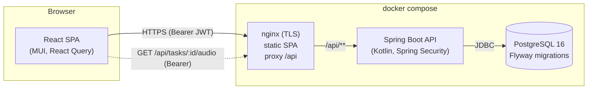
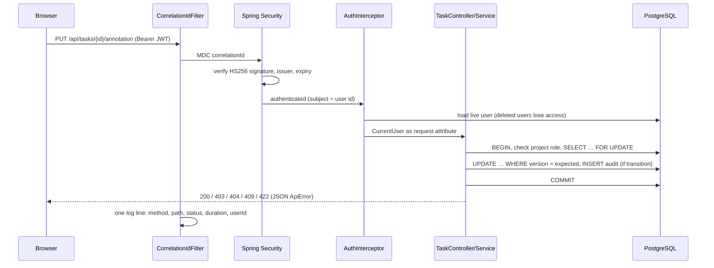
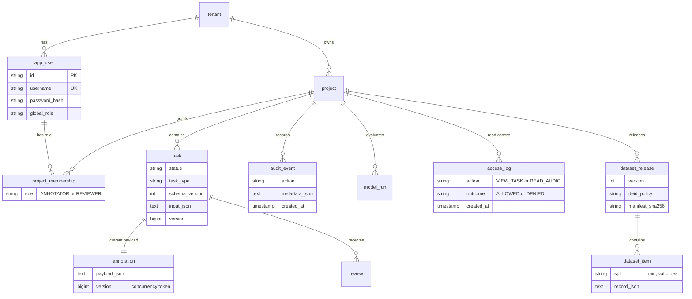
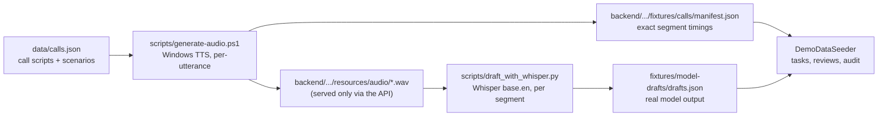

# Architecture

Call Quality Analyser is a focused slice of a bank's call-quality and ML data platform: people correct speech-model
transcripts of recorded customer calls and score each call against conduct checks, reviewers check both, every state
change is audited, and model output is evaluated against the approved data.



| Container | Responsibility | Tech |
|---|---|---|
| `frontend` | Terminates TLS, serves the built SPA with security headers, proxies `/api/`; HTTP only redirects | nginx, React 18, TypeScript, MUI 6, React Query, Vite |
| `backend` | Authentication, authorization, task lifecycle, validation, audit + access log, recordings, evaluation (no published port) | Kotlin, Spring Boot 3.4, Spring Security (OAuth2 resource server), JDBC |
| `db` | System of record | PostgreSQL 16 (H2 in PostgreSQL mode for the backend test suite) |

## Backend modules

```
backend/src/main/kotlin/com/callquality/analyser/
  auth/         sign-in, JWT issue/verify, CurrentUser resolution, AccessService (project roles), admin API,
                user management (add/edit accounts and project roles, account_event trail, session revocation)
  tasks/        TaskController, TaskService (lifecycle), TaskRepository (SQL), status model
  annotations/  task-type registry: JSON Schema + per-type business rules
  audit/        AuditRepository (same-transaction inserts), AccessLogRepository (read access), history endpoint
  evaluation/   WER calculator and the evaluation report built from committed fixtures
  datasets/     training-data release ETL: Deidentifier, DatasetService (extract, transform, load), admin API
  drafts/       model drafts (model-assisted annotation): stored per task with model name, version, provenance
  demo/         seeder (core + realistic dataset from the manifest) and the operator-only reset
  platform/     platform-operator API (tenant overview: counts only)
  common/       error model, exception mapping, correlation-id filter, pseudonymizer
```

### Request path



- **Authentication** (`auth/Security.kt`): stateless, HS256 JWT with an 8 h lifetime, issued after a bcrypt check.
  Only the account role (`USER`/`ADMIN`) is in the token.
- **Tenancy**: shared database and schema; `tenant_id` on users and projects, everything else reached through its
  project. Tenant admins act only inside their tenant; the platform operator (own tenant, `OPERATOR` role) runs
  cross-tenant operations without access to any tenant's content.
- **Authorization** (`auth/Auth.kt`, `TaskService`): project role from `project_membership` on every request,
  scoped to the caller's tenant. Non-members get 404 so foreign ids are not confirmed; the wrong role gets 403;
  reviewers cannot review their own work. Admin endpoints use `@PreAuthorize("hasRole('ADMIN')")`.
- **Lifecycle** (`tasks/`): `IN_PROGRESS → SUBMITTED → APPROVED | CHANGES_REQUESTED → SUBMITTED …`, see
  [concurrency.md](concurrency.md) for how transitions stay correct under concurrent requests.
- **Validation** (`annotations/`): every save is checked against the task type's JSON Schema; submit adds
  completeness rules (e.g. "every segment needs text"). Violations come back as actionable 422 messages.
- **Audit** (`audit/`): written in the same transaction as the transition it records ([ADR 0003](adr/0003-transactional-audit.md)).
- **Read-access log** (`audit/AccessLog.kt`): task views and recording fetches, allowed and denied, are written
  before any data is returned; a failed log write fails the read. Admins query it per tenant.
- **Recordings** (`TaskService.audio`): served from backend resources only to project members, `no-store`;
  task detail returns the API URL, never a storage path. The SPA fetches with the token and plays a `blob:` URL.
- **Training-data releases** (`datasets/`): approved annotations → de-identified, versioned, hashed releases;
  see [data-flow.md](data-flow.md).
- **Evaluation** (`evaluation/`): corpus-level WER computed from committed reference transcripts and model-output
  fixtures; nothing is simulated at request time.

### Data model



Migrations: `V1__init.sql` (schema), `V2__auth.sql` (username, password hash, account role), `V3__access_log.sql`, `V4__dataset_release.sql`, `V5__platform_operator.sql`, `V6__model_draft.sql`, `V7__user_management.sql` (account_event, sessions_valid_after).

## Frontend modules

```
frontend/src/
  app/             theme (light/dark CSS variables), AppShell (sidebar, breadcrumbs, account menu), routes
  shared/          api client (Bearer token, 401 handling), auth context, formatting, status chips, hooks
  features/
    auth/          sign-in page
    tasks/         queue (KPIs, status tabs, search, filters)
    annotation/    TaskPage + AnnotationWorkspace (autosave, undo, validation, submit, shortcuts)
    review/ audit/ reviewer decision panel, audit timeline
    evaluation/    WER dashboard
    admin/         users & roles, permission matrix, access log
    platform/      operator page: organisations and demo reset
    datasets/      training-data releases (pipeline, create, preview, download)
  task-editors/    registry + one editor per task type (transcription with waveform, QA scorecard)
```

The workspace is task-type agnostic: it owns autosave, undo, validation and submit, and asks the
**editor registry** for the UI of `(taskType, schemaVersion)` ([ADR 0001](adr/0001-task-type-extensibility.md)).
The transcription editor decodes the clip with Web Audio to draw the waveform, colours it by speaker, places
overlapping segments on separate lanes and supports keyboard-first work (`K`, `N`, `Ctrl+S`, `Ctrl+Enter`).

## Test data pipeline



See [testing.md](testing.md#test-data) for what is seeded and why.

## Deployment and operations (demo)

`docker compose up --build` starts the three containers (UI on https://localhost:8443, HTTP :8080 redirects, API and
database not reachable from the network); Flyway migrates on start and the seeder fills an empty
database. Logs are ECS JSON with a correlation id per request and never contain payloads, transcripts or tokens.
Production hardening that is deliberately not implemented is listed in the README.
