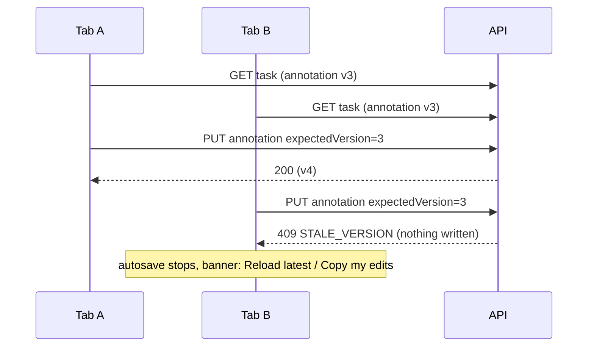

# Concurrency

Annotation looks single-user ("one assignee per task") but concurrency is everywhere: the same person in two tabs,
autosave racing submit, a reviewer deciding while the annotator is still typing, two reviewer tabs, and several
API instances. The rule is simple: **no write is ever silently lost, and every state transition happens exactly
once.** All of it is enforced in the database, so it holds for any number of API instances.

## Mechanisms

| Mechanism | Where | Protects against |
|---|---|---|
| `annotation.version` compare-and-set: `UPDATE annotation … WHERE task_id = ? AND version = ?` | `TaskRepository.updateAnnotation` | Lost updates between tabs / sessions. 0 rows updated → **409 `STALE_VERSION`**. |
| Task row lock: `SELECT id FROM task WHERE id = ? FOR UPDATE` before save, submit and review | `TaskRepository.lock`, called from `TaskService` | Save/submit/review interleaving on the same task; serialises them. |
| Status compare-and-set: `UPDATE task SET status = ? … WHERE id = ? AND status = ?` + `task.version + 1` | `TaskRepository.updateStatus` | Double transitions (two reviewers, double-click). 0 rows → **409 `INVALID_TRANSITION`**. |
| Explicit transition table | `TaskStatus.canTransitionTo` | Illegal transitions (e.g. approve an in-progress task). |
| Audit insert in the same transaction | `AuditRepository.insert` inside `@Transactional` service methods | A transition without its audit event, or an audit event for a rolled-back transition ([ADR 0003](adr/0003-transactional-audit.md)). |
| Editable-state check under the lock | `TaskService.saveAnnotation` | Saving after the task was submitted/approved → **409 `INVALID_STATE`**. |
| Client: one save in flight, debounced 800 ms, saves chained | `useAutosave` | The browser racing itself (out-of-order saves). |
| Client: stop on conflict | `useAutosave` (`conflict` state) | Autosave hammering a stale version; the user chooses *Reload latest* or *Copy my edits*. |
| Submit = save-now, then submit with the version that save returned | `AnnotationWorkspace.handleSubmit` | Submitting content older than what is on screen. |

## Scenarios

### Two tabs edit the same task

Covered by `WorkflowIntegrationTest` ("stale write returns 409 and does not overwrite") and the end-to-end test
`concurrency.spec.ts` ("a stale tab is stopped with a conflict").

### Autosave races submit

Submit first calls `saveNow()` (waits for any in-flight save, then flushes pending edits) and submits with the
version returned by that save. On the server, submit takes the row lock and compares `expectedVersion` with the
current annotation version, so a save that slipped in between makes submit fail with 409 instead of submitting
stale content.

### Reviewer acts while the annotator's editor is open

Review takes the row lock, changes the status with a compare-and-set and bumps `task.version`. The annotator's
next autosave fails with `INVALID_STATE` (task no longer editable) or `STALE_VERSION`; nothing is overwritten.
Covered by "annotator with a stale editor cannot save after the reviewer acted".

### Two review decisions on one submission

Both requests lock the task row in turn. The first moves `SUBMITTED → APPROVED`; the second finds the task no
longer `SUBMITTED` and gets **409 `INVALID_TRANSITION`**. Exactly one review row and one audit event exist.
Covered by the end-to-end test "two reviewers cannot both decide on the same submission".

### Failure between transition and audit

The transition and its audit insert share one transaction. `WorkflowIntegrationTest` injects a failure into the
audit insert and asserts the status change was rolled back too.

## Why optimistic (with a short lock) and not pure pessimistic locking

- Editing sessions last minutes; holding database locks or "edit locks" for that long blocks people and needs
  lock expiry/recovery. Versions cost nothing while nobody else writes, which is the normal case.
- The `FOR UPDATE` lock is held only for the few milliseconds of one request, purely to serialise the
  check-then-write steps of save/submit/review on one task.
- Conflicts are rare and visible: the user decides, the system never merges silently.

Not chosen: field-level merge or CRDTs (real-time co-editing is out of scope: one assignee per task), and
last-writer-wins (loses work).

## Measured behaviour under load

The load test deliberately makes several virtual annotators autosave the same few tasks
([load-test.md](load-test.md)). Results: 0 server errors, 0 lost updates by construction, and the expected share
of 409s (about half of all contended saves at 50 users) with p99 save latency of 25 ms at 50 users with think time (over HTTPS).
A 409 costs one extra GET to reload the latest version.

## Limits and next steps

- Conflicts are resolved by reload; a diff/merge view for the conflicting segments would reduce rework.
- Long-running batch jobs (model runs) would need their own idempotency keys and a job table, not row locks.
- Under very high contention on a single task the row lock serialises requests; that is intended (one assignee).
