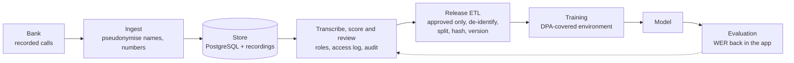

# Data flow: from recorded call to model

How customers' personal data in recorded bank calls moves through the platform, which control applies at each
step, and what is still missing before real calls may flow. All data in this repository is synthetic.



## Stages and controls

| Stage | Data | Controls in place | Still missing for real calls |
|---|---|---|---|
| Ingest | Recording, call notes | Names and long numbers (phone, account, card) replaced by tokens before storage (`Pseudonymizer`) | Ingest API with per-bank credentials; tokens are an **unsalted hash** of the value (reversible with a candidate list): switch to a keyed HMAC with a managed secret |
| Store | Tasks, transcripts, scorecards, recordings | Tenant-scoped queries; recordings only via `GET /api/tasks/{id}/audio`; API and database not reachable from outside | Encryption at rest (database volume, object storage), backups, retention and deletion per the bank's record-keeping rules |
| Model draft | First-draft transcripts | Real model output stored unchanged with model name, version and provenance; pseudonymised on ingest like all text | Run the model as a service per incoming call, inside the same controls |
| Transcribe, score and review | Transcripts, QA scorecards, audio playback | Project roles checked per request, four-eyes review, audit of every state change, read-access log incl. denied attempts, TLS, CSP | SSO + MFA, access reviews |
| Release ETL | Approved transcripts and scorecards | Admin-only, tenant-scoped; de-identification `pii-text-v1`; release-local person surrogates; stable splits; immutable versioned release with SHA-256; release and every download audited | Audio redaction; NER-based detection of free-text identifiers (addresses); human QA sample per release |
| Training | Manifest + recordings | Every record carries lineage (`task_id`, `annotation_version`) and `contains_identifiers` for audio; manifest hash lets the job verify its input | The DPA-covered environment itself (training orchestration, model registry, model card linking the release) |
| Evaluation | Model output | Drafts measured against approved transcripts (words corrected, segments accepted as-is), so the numbers are real; benchmark fixtures stay labelled as samples | Number normalisation / a style guide so "€15,000" vs "fifteen thousand euros" does not count as an error; per-release model comparisons |

## The release (`POST /api/admin/projects/{id}/datasets`)

One database transaction: **extract** the project's `APPROVED` tasks with their current annotation version,
**transform** each into a de-identified record, **load** the release and its records, audit `DATASET_RELEASED`.
A release never changes afterwards; the next one gets the next version number. The manifest
(`GET /api/admin/datasets/{id}/manifest.jsonl`, JSON Lines) is served exactly as hashed, with the hash in the
`X-Manifest-SHA256` header, and every download is audited as `DATASET_EXPORTED`.

A transcription record (speech model training):
```json
{"type":"TRANSCRIPTION","split":"train",
 "source":{"task_id":"t-call-04","annotation_version":3},
 "audio":{"file":"call-04.wav","sha256":"…","duration_ms":21466,"contains_identifiers":true},
 "segments":[{"start_ms":350,"end_ms":3887,"speaker":"AGENT","label":"CLEAR",
   "text":"Am I speaking with Mister [PERSON_1], the main account holder?"}]}
```
A QA scorecard record (call-quality model training: transcript in, checks and outcome out):
```json
{"type":"CALL_SCORECARD","split":"train","source":{"task_id":"t-score-03","annotation_version":3},
 "transcript":[{"speaker":"AGENT","text":"Am I speaking with Mister [PERSON_1], the main account holder?"}],
 "checks":{"IDENTITY_VERIFIED":"PASS","PURPOSE_STATED":"PASS","AFFORDABILITY_CHECKED":"NOT_APPLICABLE"},
 "outcome":"COMPLIANT","notes":""}
```

- **Splits** are derived from a hash of the task id (80 / 10 / 10), so a task stays in the same split in every
  release and test data never leaks into training across versions.
- **Lineage**: each record names the task and annotation version it came from; the release names its policy.

## De-identification policy `pii-text-v1`

Removes the personal data that occurs in bank call transcripts (GDPR personal data, PCI DSS card data).

| Category | Replaced by | Examples |
|---|---|---|
| Names | `[PERSON_1]`, `[PERSON_2]`, … per release | ingest tokens `[PERSON_3fa2c1]` are re-keyed, so surrogates are never derived from the name and cannot be linked across releases |
| Numbers masked on ingest | `[NUMBER]` | phone, account or card numbers already tokenised as `[NUMBER_…]` |
| IBANs | `[IBAN]` | `DE89 3704 0044 0532 0130 00` |
| Payment card numbers | `[CARD]` | `4111 1111 1111 1111` |
| Telephone numbers | `[PHONE]` | `+49 30 1234567` |
| Dates (not the bare year) | `[DATE]` | `12.03.2024`, `March 14, 2024`, `3rd April` |
| E-mail addresses | `[EMAIL]` | `name@example.org` |
| URLs | `[URL]` | `https://…`, `www.…` |
| Long numeric identifiers | `[ID]` | customer, reference or contract numbers (5+ digits) |

Amounts, interest rates, fees, the last four digits of an account and bare month names are kept: they are what a
speech model has to learn to transcribe. Redaction counts per category are stored with the release and shown on
the *Training data* page.

## Known risks (be explicit about them)

1. **Audio is not de-identified.** Names and account details are spoken in the recordings. Records say so; audio
   may only be used inside an environment covered by a data processing agreement. Production needs audio redaction
   (bleeping aligned to detected entities) or a transcript-only release.
2. **Rule-based text de-identification misses things**: unusual names not caught at ingest, postal addresses,
   security answers ("my mother's maiden name is …"), numbers spoken as words. Production needs an NER model plus
   a human QA sample per release.
3. **Ingest pseudonyms are reversible** with a list of candidate names (unsalted, truncated hash). The release
   step removes them, but the stored data should use a keyed HMAC.
4. **Card data must never be stored in clear.** The ingest masks long numbers, but a real deployment keeps
   recordings with card numbers out of scope entirely (pause-and-resume recording or DTMF capture), as PCI DSS
   expects.
5. **The demo reset deletes logs and releases of every tenant.** Only the platform operator may run it (never a
   tenant admin); it exists for the local demo only and must be disabled
   (`app.demo-endpoints.enabled=false`) anywhere else.
6. **Contracts and law are outside the code**: a DPA with every processor, a DPIA, call-recording consent and
   notices, retention rules from banking regulation, and hosting in the right region.
